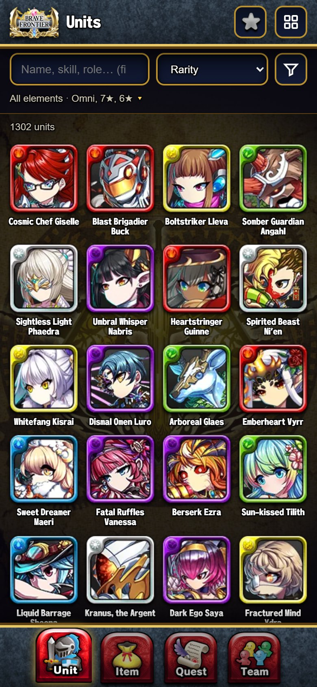
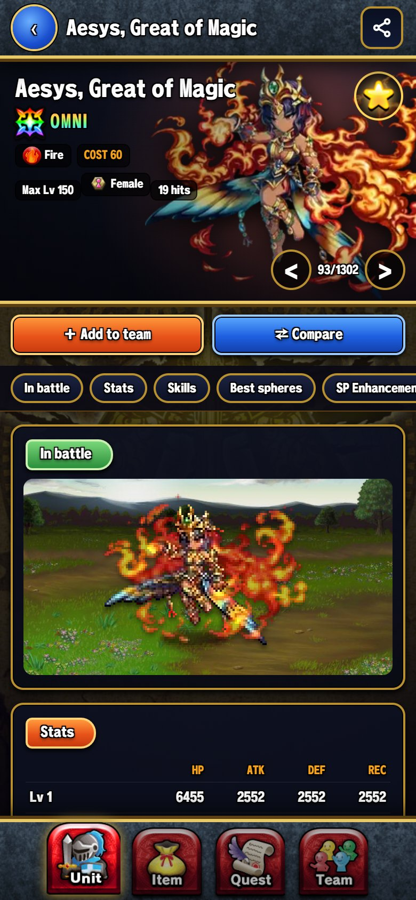
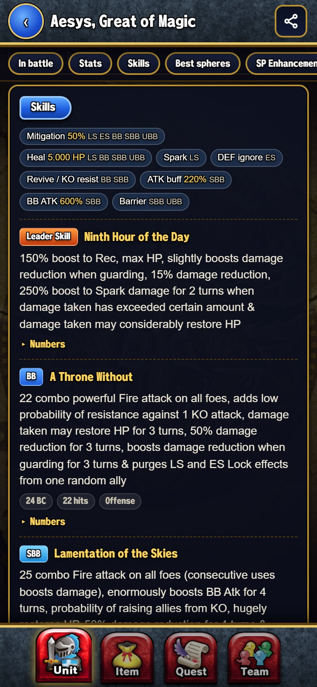
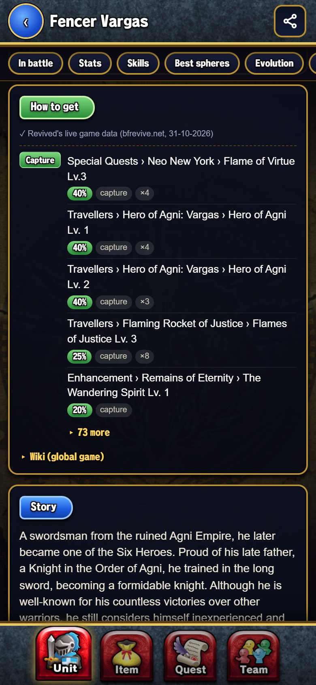
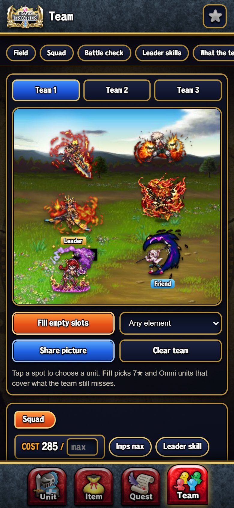
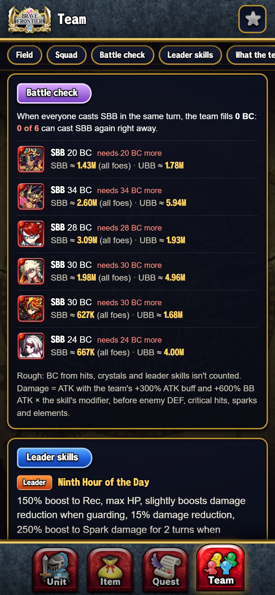
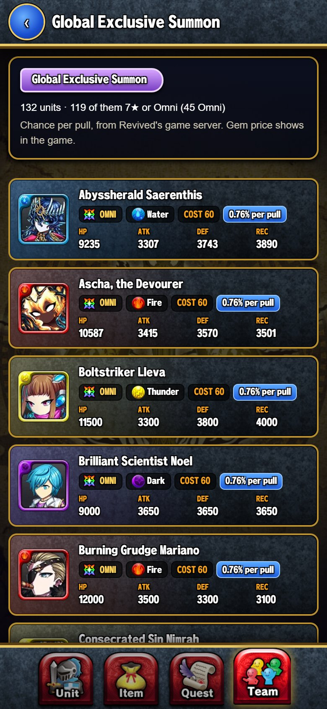
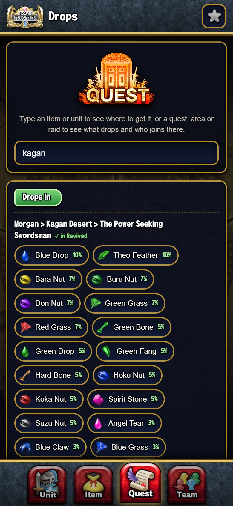

# BF Companion

An offline Android guide for **Brave Frontier Revived**: every unit, sphere, drop and summon gate in your
pocket, plus a team builder that shows your squad's numbers like the game's Manage Squad screen.

No account, no ads, no internet needed: everything is inside the app. If you want, it checks GitHub for new versions
and installs them for you.

**[⬇ Download the latest APK](../../releases/latest)** · ✅ Collects nothing · ✅ Offline (online only to check for updates, if you want) · ✅ [Code you can read](app) · ✅ [Scanned on VirusTotal (4.9)](https://www.virustotal.com/gui/file/4a0becfd3c7d33b522ca3ecc7b6105d0245334f8b0ad832bdbb7cdcc6cafebd6) · [Is it safe?](#is-it-safe)

Slow download from GitHub? Get the APK from the **[Google Drive mirror](https://drive.google.com/file/d/1uFvBd24L8b5KQAOG_Wnh-q1i7tvH-koN/view)** (Google says it can't scan files this big for viruses: tap *Download anyway*).

  
  
  
  

  
  
  
  

## What's inside

**Units**
- All 2,292 units with artwork and their **animated battle sprite**, taken from the game's own files. Save the sprite
  as a **GIF** to share, on the app's battle background or see-through.
- Stats for every type (Lord, Anima, Breaker, Guardian, Oracle) of every unit, Imps, max level.
- Leader Skill, BB, SBB, UBB, Extra Skill and Dual BB with BC cost, hits and the exact numbers.
- Roles with how strong they are ("Mitigation 50%", "BB ATK 600%"), evolution line and materials, lore.
- SP enhancements with the players' suggested SP builds from the Brave Frontier Wiki, the build's options ticked.
- All in English: units from the Japanese game show the game's own English, and a fan translation where it has none.
- Search by name, skill text or role, several words at once: `fire omni heal`, `def ignore`, `water mitigation`.
  A typo still finds it: *Did you mean…?* shows the closest names.
- **Similar units** on every unit page: the same element and roles, for when you don't have one.
- **My box**: mark the units you have (many at once with *Edit box*), filter the list to them, see what you're
  missing in each summon gate, and build teams from your own units.
- Sort by rarity, **element**, newest, stats, cost or the strongest unit for a role.

**How to get them in Revived**
- Summon gates the unit is in, with the **chance per pull** and the chance to get it in 10 pulls.
- Quests where you can **capture** it, with the capture chance; clear rewards; event shops.
- Every quest it **fights in as an enemy**, also where it can't be captured or a capture gives another unit.
- Only Revived's own data: for a unit you can't get directly, the earlier form you can get and how, then you evolve it.
- A page for every summon gate, and a *Get it* filter (This week, Summon, Capture, Reward / shop).
- Every Vortex quest with its banner from the game, like the game's quest list (tap it to see it big).

**Elgifs**
- All 541 Elgifs (the extra skills an Imbued Tablet Elgif gives a unit) from the game's own files, with rarity and effect.
- The ones Revived gives, with how: Frontier Hunter ranks, Frontier Gate and Eternal Crusade floors or points, Frontier Rift
  and Frontier Spire milestones, Grand Quest episodes, quest first clears and achievements. Search by name, effect or where,
  or filter by each way to get them.

**Spheres and items**
- Every sphere and material with Revived's own ways to get it: drops (chance per kill or per hit), clear rewards, shops,
  raid drops, Arena rank rewards, achievements and Synthesis. Something Revived doesn't give says so, and *craftable*
  means every material can be had. Filter by sphere type, element, or only what Revived gives.
- **Crafting planner**: all base materials and Karma for any Synthesis recipe, for any amount, and **where to farm**
  each material with its drop chance.
- Suggested spheres for each unit: the ones that switch on its extra skill, then the spheres Revived gives that suit
  what it does (damage or support, its element), and stronger ones Revived doesn't give yet.

**Quest search**
- Type an item to see where it drops in Revived, or a quest or area to see what drops there and which units you can capture.

**Team builder**
- Up to 10 named teams of 5 units + a friend, on a battle field with the animated sprites.
- Squad numbers like the game: HP, ATK, DEF, REC with the unit type, spheres, leader skill, friend skill, extra skills and Imps.
- **Battle check**: how much BC the team's skills fill (also per spark, and from leader and extra skills), who can cast
  SBB again right away, and rough BB/SBB/UBB damage from every attack, with the game's own modifiers.
- **Spark estimate**: how many of the team's hits spark in slot order, the best casting order and each unit's share,
  from the game's hit frames and the community's Automatic Sparking Simulator timings.
- What the team covers (mitigation, healing, BB fill, buffs…), *Fill empty slots* with units that cover what's missing,
  newer units first: from the units you can get in Revived, or only from your box.
- **Against each element**: how many of your units hit each enemy element hard or weakly, and the team's best element.
- Choosing a leader or friend shows each unit's leader skill.
- Share your team as a picture.

**Also:** favorites, recently viewed, compare up to 3 units side by side, the element chart, swipe between units, and
*What's new* in every version and **updates from inside the app** (tap the logo).

## Install

1. Download `BF-Companion.apk` from the [latest release](../../releases/latest) on your phone (or from the
   [Google Drive mirror](https://drive.google.com/file/d/1uFvBd24L8b5KQAOG_Wnh-q1i7tvH-koN/view) if GitHub is slow).
2. Open it and allow installing apps from your browser or file manager when Android asks.
3. Done. For later versions you don't need this page: tap the logo, then *Privacy → Check for updates*.

Android 7.0 or newer. About 115 MB, because every unit's artwork and animated sprite is included.

**Every version and what changed in it:** [Releases](../../releases). Older versions stay there to download.

Android warns about "unknown apps" for **every** APK installed from outside the Play Store; that warning doesn't
mean anything is wrong. If Google Play Protect offers to scan the app, let it.

## Is it safe?

Yes, and you don't have to take my word for it:

- **It only goes online when you ask, and only to GitHub.** Updates are off until you tap *Check for updates* or turn on
  *Check for updates automatically* (tap the logo, then *Privacy*). Then the app asks GitHub's API for this repo's newest
  release. If you tap *Download and install*, it downloads that release's APK, checks it against the SHA-256 GitHub gives
  for it, and hands it to Android, which asks you before installing and only takes an APK signed with the same key.
  The app's pages still can't load anything that isn't built in
  ([MainActivity.java, line 76](app/src/sg/bf/companion/MainActivity.java#L76)).
- **Two permissions, both only for updates.** *Internet*, to ask GitHub, and *Install unknown apps*, to hand the new
  version to Android's installer (Android asks you to allow it the first time). Android's own tool lists exactly these
  two for the APK (`aapt2 dump permissions`).
- **It collects nothing.** No account, no ads, no analytics, no trackers. Your favorites and teams are saved only
  on your phone, in the app's own storage, and are gone when you uninstall it.
- **The only file it ever writes** is a picture you choose to share or save (a unit or team card, or a sprite GIF), in
  *Pictures/BF Companion*.
- **Read the code.** The [`app`](app) folder holds everything that makes the APK:
  - [`AndroidManifest.xml`](app/AndroidManifest.xml): what the app is allowed to do (the two update permissions, nothing else).
  - [`MainActivity.java`](app/src/sg/bf/companion/MainActivity.java): the whole Android part, about 390 lines. It
    shows the app's pages, colours the phone's status and navigation bars, saves or shares a picture when you tap
    *Share* or *Save GIF*, handles the back button, and checks for and installs updates when you ask.
  - [`www/index.html`](app/www/index.html): the app itself. An APK is a zip file: unzip it and you'll find this
    exact file as `assets/www/index.html`. The rest of the APK is the game data, artwork and sprites it shows.
  - [`build_apk.bat`](app/build_apk.bat): how the APK is built with Google's Android tools.
- **Checked by antivirus engines on VirusTotal:** [see the scan of version 4.9](https://www.virustotal.com/gui/file/4a0becfd3c7d33b522ca3ecc7b6105d0245334f8b0ad832bdbb7cdcc6cafebd6),
  with the result of every engine. Later versions are built the same way, with their code in [`app`](app).

## Where the data comes from

- **The game's own files**: unit, skill, sphere, item and Elgif data, artwork, sprites and icons.
- **[bfrevive.net](https://bfrevive.net/)**: Revived's server data for drops with chances, capture spots, the quests every unit
  fights in, summon gates and shops.
- **[Brave Frontier Wiki](https://bravefrontierglobal.fandom.com/)**: skill numbers, SP enhancements, lore and evolution details.

The data is a snapshot from the day the APK was built; new versions come with fresh data (*Check for updates* in the app finds them).

## Credits

Made by [@Nervequakes](https://github.com/Nervequakes).

Thanks to the BF Revive team for bringing the game back and publishing its data, to the Brave Frontier Wiki editors, and
to the makers of the Automatic Sparking Simulator (and BluuArc's Project Sparkle) for the spark timings.

*BF Companion is a fan-made guide and is not affiliated with gumi Inc., Alim or the BF Revive team. Brave Frontier, its
characters, artwork and sprites belong to their owners.*
